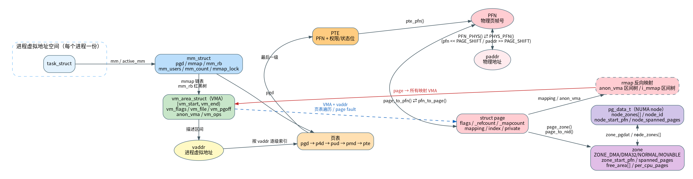

# 内存管理核心数据结构与地址转换

> 对应问题：[内存管理知识点.md](内存管理知识点.md)
>
> 内核：Linux 5.15（`runninglinuxkernel_5.15`，RISC-V，`CONFIG_FLATMEM=y`、`CONFIG_NUMA=n`、`CONFIG_PGTABLE_LEVELS=3`、`CONFIG_TRANSPARENT_HUGEPAGE=n`）
>
> 图：[mm_struct_map.png](mm_struct_map.png)（可放大） / [mm_struct_map.svg](mm_struct_map.svg) / [mm_struct_map.dot](mm_struct_map.dot)（Graphviz 源文件）

---

## 怎么用这篇

- **第一次读**：第 0、1、2 节建立整体图，再读第 3 节的结构速查。
- **忘了某个转换**：直接翻第 4 节，9 个问题逐条有代码和源码位置。
- **想看完整路径**：第 5 节的缺页、GUP、rmap 三条路径。
- **复习/自测**：先看第 8 节的 30 秒回忆版，再回头看第 6 节的易混点。
- **查源码**：第 7 节按“结构体/正向/反向/换算/分配”分类。

---

## 0. 先记一句话

内存管理不是“一堆结构体”，而是一条**从进程虚拟地址到物理页，再反查所有映射**的链路：

```text
mm_struct → VMA → vaddr → 页表 → PTE → PFN → struct page
                                              │
                                              ├→ paddr
                                              ├→ zone → pg_data_t
                                              └→ rmap → VMA（所有映射）
```

一句口诀：

> **mm 管地址空间，VMA 管区间，PTE 管翻译，page 管物理页，PFN 管编号，zone/pg_data 管分配，rmap 管反查。**

最容易忘的不是定义，而是三个“不是”：

1. **VMA 不是页表**：VMA 只是“这段虚拟地址怎么用”的描述，页表才是实际映射；`mmap()` 后可能一个物理页都没分配。
2. **page 没有唯一的 vaddr**：同一个物理页可以同时被多个进程、多个 VMA、内核直接映射、`kmap`/`vmalloc` 映射；问“page 的 vaddr”必须先说“哪个 mm、哪个 VMA”。
3. **PTE 不是 `struct page *`**：PTE 里存的是 PFN + 权限位；`pte_page()` 只是 `pfn_to_page(pte_pfn())`，只对普通 RAM 映射成立。

---

## 1. 设计精髓：五层抽象

| 层 | 数据结构 | 回答的问题 | 生命周期 |
|---|---|---|---|
| 地址空间 | `mm_struct` | 这是哪个进程的地址空间？页表根在哪？ | 进程创建/退出，`mm_users/mm_count` |
| 区间语义 | `vm_area_struct`（VMA） | `[vm_start, vm_end)` 这段地址是什么？可读/可写/文件/匿名？ | `mmap`/`munmap`/`mremap`，可合并/拆分 |
| 实际映射 | 页表 + PTE | 某个 vaddr 现在翻译到哪个 PFN？权限是什么？ | 缺页时建立，`munmap`/回收时清除 |
| 物理页元数据 | `struct page` | 这个 PFN 的页是什么类型、被谁引用、映射了几次？ | 分配器管理，引用计数到 0 才回收 |
| 分配管理 | `pg_data_t` → `zone` → buddy/pcp | 这个页从哪个 NUMA 节点、哪个 zone、哪个 order 分配？ | 启动时建立，内存热插拔可变化 |

再加一层**反向映射（rmap）**：

- 正向：`vaddr → VMA → PTE → page`
- 反向：`page → 所有映射它的 VMA/vaddr`

正向是“查表”，反向是“从物理页找回所有使用者”。共享页、回收、迁移、COW、`munmap` 都依赖反向映射。

---

## 2. 关系图



看图时抓住三条线：

1. **地址空间线**：`task_struct → mm_struct → VMA`；
2. **翻译线**：`mm_struct->pgd → 页表 → PTE → PFN → struct page`；
3. **管理/反查线**：`page → zone → pg_data_t`，以及 `page → rmap → VMA`。

图中实线是“正向查找”，虚线是“反向或双向换算”。红色是 rmap 反查，蓝色是 VMA + vaddr 走页表找 page。

---

## 3. 核心结构速查

### 3.1 `mm_struct`：一个进程的地址空间

关键字段（`include/linux/mm_types.h:402`）：

```c
struct mm_struct {
    struct vm_area_struct *mmap;  /* VMA 链表，按地址排序 */
    struct rb_root mm_rb;         /* VMA 红黑树 */
    pgd_t *pgd;                   /* 页表根 */
    unsigned long task_size;      /* 用户地址空间大小 */
    atomic_t mm_users;            /* 用户态使用者数量 */
    atomic_t mm_count;            /* 结构体引用计数 */
    struct rw_semaphore mmap_lock;/* 保护 VMA 和 mmap 相关操作 */
    ...
};
```

要点：

- `mm_struct` 是**每个进程地址空间**的所有者；`task_struct->mm` 指向它，内核线程可能借用 `active_mm`。
- `pgd` 是页表根，`mmap/mm_rb` 是 VMA 的两种索引（链表 + 红黑树）。
- `mm_users` 和 `mm_count` 不是一回事：前者是“用户态共享地址空间的进程数”，后者是“内核里还有多少地方引用这个 mm”。
- `mmap_lock` 保护 VMA 树、`mmap`/`munmap`、缺页路径；`find_vma()` 要求持锁。

源码：

- `include/linux/mm_types.h:402`：`struct mm_struct`
- `include/linux/mm_types.h:421`：`pgd_t *pgd`
- `mm/mmap.c:2273`：`find_vma()`
- `include/linux/mm.h:2713`：`vma_lookup()`

### 3.2 `vm_area_struct`：一段虚拟地址的“合同”

关键字段（`include/linux/mm_types.h:319`）：

```c
struct vm_area_struct {
    unsigned long vm_start, vm_end;  /* [start, end) */
    struct vm_area_struct *vm_next, *vm_prev;
    struct rb_node vm_rb;            /* 红黑树节点 */
    struct mm_struct *vm_mm;         /* 属于哪个地址空间 */
    pgprot_t vm_page_prot;
    unsigned long vm_flags;          /* VM_READ/WRITE/EXEC/SHARED... */
    struct anon_vma *anon_vma;       /* 匿名页反向映射 */
    const struct vm_operations_struct *vm_ops;
    unsigned long vm_pgoff;          /* 文件偏移，单位 PAGE_SIZE */
    struct file *vm_file;            /* 文件映射，匿名映射为 NULL */
    void *vm_private_data;
    ...
};
```

要点：

- VMA 描述的是**一段连续虚拟地址区间**，不是一个个页；`mmap()` 只是建立 VMA，物理页通常到缺页才分配。
- `vm_flags` 决定权限和语义：`VM_READ/WRITE/EXEC`、`VM_SHARED`、`VM_GROWSDOWN`、`VM_PFNMAP`、`VM_MIXEDMAP` 等。
- `vm_file + vm_pgoff` 表示文件映射的“文件 + 页偏移”；匿名映射 `vm_file == NULL`，用 `anon_vma` 做反向映射。
- VMA 可以被合并、拆分、移动；不要把 VMA 指针当永久有效，除非持有 `mmap_lock` 并理解生命周期。

源码：

- `include/linux/mm_types.h:319`：`struct vm_area_struct`
- `include/linux/mm_types.h:354`：文件映射的 `shared` 区间树节点
- `include/linux/mm_types.h:365`：`anon_vma_chain`

### 3.3 页表与 PTE：真正的翻译表

RISC-V 当前配置是 `CONFIG_PGTABLE_LEVELS=3`，逻辑层级：

```text
pgd → p4d（折叠）→ pud → pmd → pte
```

- `mm->pgd` 是根；`pgd_offset(mm, addr)` 定位 PGD 项；
- 逐级 `p4d_offset()`、`pud_offset()`、`pmd_offset()`、`pte_offset_map()` 找到 PTE；
- `PTE` 里存 **PFN + 权限/状态位**，不是 `struct page *`；
- 页表页本身也是物理页，由 buddy 分配，`struct page` 里用 `PageTable` 标记。

源码：

- `include/linux/pgtable.h:122`：`pgd_offset_pgd()`
- `include/linux/pgtable.h:131`：`pgd_offset(mm, addr)`
- `include/linux/pgtable.h:96` / `:101`：`pte_offset_map()`
- `include/linux/mm.h:2264`：`pte_offset_map_lock()`
- `arch/riscv/include/asm/pgtable.h:252`：`pte_pfn()`
- `arch/riscv/include/asm/pgtable.h:257`：`pte_page()`
- `arch/riscv/include/asm/pgtable.h:260`：`pfn_pte()`

### 3.4 `struct page`：物理页的“身份证”

关键字段（`include/linux/mm_types.h:70`）：

```c
struct page {
    unsigned long flags;       /* 页状态 + node/zone/section 编码 */
    union {
        struct {               /* page cache / anon page */
            struct list_head lru;
            struct address_space *mapping;
            pgoff_t index;
            unsigned long private;
        };
        /* slab / page_pool / page table / compound tail ... 复用 union */
    };
    atomic_t _mapcount;        /* 被多少用户 PTE 映射 */
    atomic_t _refcount;        /* 总引用计数 */
    ...
};
```

要点：

- `flags` 不是只有“页状态位”，还编码了 **node id、zone id、section id**；`page_to_nid()`、`page_zonenum()` 都从这里取。
- `mapping` 有两种身份：
  - 文件页：指向 `struct address_space`；
  - 匿名页：指向 `anon_vma`，但指针最低位加了 `PAGE_MAPPING_ANON` 标记，所以 `PageAnon()` 用位判断。
- `index` 是“在 mapping 里的页偏移”，不是用户 vaddr；匿名页的 `index` 在建立 rmap 时被设为 `linear_page_index(vma, addr)`。
- `_mapcount` 是“用户页表映射计数”的底层字段（无映射时从 -1 开始，`page_mapcount()` 返回实际映射数）；`_refcount` 是“总引用计数”；两者不是一回事。
- `struct page` 是 union 复用：slab 页、page table 页、compound tail 页、ZONE_DEVICE 页的字段含义不同；不能对任意 page 读 `mapping/index/private`。

源码：

- `include/linux/mm_types.h:70`：`struct page`
- `include/linux/mm_types.h:88`：`mapping`
- `include/linux/mm_types.h:89`：`index`
- `include/linux/mm_types.h:196`：`_mapcount`
- `include/linux/mm_types.h:216`：`_refcount`
- `include/linux/page-flags.h:491`：`PAGE_MAPPING_ANON`
- `include/linux/page-flags.h:501`：`PageAnon()`
- `include/linux/mm.h:873`：`page_mapcount()`
- `mm/util.c:678`：`page_mapped()`

### 3.5 PFN 与 paddr：物理地址的两种表示

- **PFN**：Page Frame Number，物理页帧号，单位是“页”。
- **paddr**：物理字节地址。

```text
paddr = PFN_PHYS(pfn) = pfn << PAGE_SHIFT
pfn   = PHYS_PFN(paddr) = paddr >> PAGE_SHIFT
```

当前 RISC-V `PAGE_SHIFT = 12`，所以 1 个 PFN = 4 KiB。

要点：

- PFN 是页帧编号，不一定对应可用 RAM；有内存空洞、MMIO、预留区，必须 `pfn_valid()`。
- `pfn_to_page()`/`page_to_pfn()` 的实现依赖内存模型：
  - 当前 `CONFIG_FLATMEM=y`：`mem_map + (pfn - ARCH_PFN_OFFSET)`；
  - `CONFIG_SPARSEMEM_VMEMMAP`：`vmemmap + pfn`；
  - `CONFIG_SPARSEMEM`：按 section 计算。
- RISC-V `CONFIG_MMU` 下 `ARCH_PFN_OFFSET = riscv_pfn_base`，不是无脑从 0 开始。

源码：

- `include/linux/pfn.h:21`：`PFN_PHYS()`
- `include/linux/pfn.h:22`：`PHYS_PFN()`
- `include/asm-generic/memory_model.h:18`：FLATMEM 的 `pfn_to_page/page_to_pfn`
- `include/asm-generic/memory_model.h:25`：VMEMMAP 的版本
- `arch/riscv/include/asm/page.h:85`：`ARCH_PFN_OFFSET`
- `arch/riscv/include/asm/page.h:147`：`phys_to_pfn()`
- `arch/riscv/include/asm/page.h:148`：`pfn_to_phys()`
- `include/linux/mmzone.h:1469`：`pfn_valid()`

### 3.6 `zone`：分配器的“分区”

`zone` 是物理页分配的管理单元，同一 zone 内的页有相同的分配约束（DMA 范围、是否可迁移等）。

当前配置常见 zone：

- `ZONE_DMA32`：32 位 DMA 可寻址范围；
- `ZONE_NORMAL`：普通可寻址内存；
- `ZONE_MOVABLE`：可迁移页，用于内存热插拔/减少不可迁移页；
- `ZONE_DEVICE`（若开启 `CONFIG_ZONE_DEVICE`）：设备内存（如 DAX），不是普通 RAM；
- 其他配置还可能有 `ZONE_DMA`、`ZONE_HIGHMEM`。

关键字段（`include/linux/mmzone.h:490`）：

```c
struct zone {
    struct pglist_data *zone_pgdat;  /* 属于哪个 NUMA node */
    unsigned long zone_start_pfn;    /* 起始 PFN */
    unsigned long spanned_pages;     /* 包含空洞的总页数 */
    unsigned long present_pages;     /* 实际存在的页数 */
    atomic_long_t managed_pages;     /* buddy 管理的页数 */
    struct free_area free_area[MAX_ORDER]; /* buddy 空闲链表 */
    struct per_cpu_pages __percpu *per_cpu_pageset; /* pcp 缓存 */
    ...
};
```

要点：

- `zone_start_pfn + spanned_pages` 给出 zone 覆盖的 PFN 范围；`zone_spans_pfn()` 可判断一个 PFN 是否落在范围内。
- `spanned_pages`、`present_pages`、`managed_pages` 不一样：分别包含空洞、实际内存、buddy 可管理内存。
- `free_area[order]` 是 buddy 的空闲链表；`per_cpu_pageset` 是 pcp 快速缓存。
- **没有通用的 `pfn_to_zone()`**；标准做法是 `page_zone(pfn_to_page(pfn))`，或遍历 zone 用 `zone_spans_pfn()`。

源码：

- `include/linux/mmzone.h:395`：`enum zone_type`
- `include/linux/mmzone.h:490`：`struct zone`
- `include/linux/mmzone.h:513`：`zone_pgdat`
- `include/linux/mmzone.h:532`：`zone_start_pfn`
- `include/linux/mmzone.h:577`：`spanned_pages`
- `include/linux/mmzone.h:608`：`free_area[]`
- `include/linux/mmzone.h:694`：`zone_end_pfn()`
- `include/linux/mmzone.h:697`：`zone_spans_pfn()`
- `include/linux/mm.h:1128`：`page_zonenum()`
- `include/linux/mm.h:1539`：`page_zone()`

### 3.7 `pg_data_t`：NUMA node

`pg_data_t` 就是 `struct pglist_data`，表示一个 NUMA 节点；节点里包含多个 zone。

关键字段（`include/linux/mmzone.h:800`）：

```c
typedef struct pglist_data {
    struct zone node_zones[MAX_NR_ZONES]; /* 本节点的 zone 数组 */
    struct zonelist node_zonelists[MAX_ZONELISTS];
    int nr_zones;
    unsigned long node_start_pfn;
    unsigned long node_present_pages;
    unsigned long node_spanned_pages;
    int node_id;
    ...
} pg_data_t;
```

关系：

```text
pg_data_t (NUMA node)
  ├── node_zones[ZONE_DMA32]
  ├── node_zones[ZONE_NORMAL]
  ├── node_zones[ZONE_MOVABLE]
  └── ...
```

要点：

- 一个 `zone` 只属于一个 `pg_data_t`：`zone->zone_pgdat`。
- 一个 `pg_data_t` 有多个 zone：`pgdat->node_zones[]`。
- 当前 `CONFIG_NUMA=n`，`NODE_DATA(nid)` 永远返回全局 `contig_page_data`；所以“节点”概念退化成一个。
- `page_pgdat(page)` = `NODE_DATA(page_to_nid(page))`。

源码：

- `include/linux/mmzone.h:800`：`struct pglist_data`
- `include/linux/mmzone.h:806`：`node_zones[]`
- `include/linux/mmzone.h:837`：`node_start_pfn`
- `include/linux/mmzone.h:841`：`node_id`
- `include/linux/mmzone.h:1075`：非 NUMA 的 `NODE_DATA()`
- `include/linux/mm.h:1544`：`page_pgdat()`

---

## 4. 九个转换问题，逐个回答

### 4.1 如何由 `mm_struct` 和 `vaddr` 找到对应的 VMA？

**答案：用 `find_vma()`，再用 `vma_lookup()` 确认地址真的落在 VMA 内。**

```c
struct vm_area_struct *vma;

vma = find_vma(mm, addr);
if (!vma || addr < vma->vm_start) {
    /* 没有精确命中：可能是空洞，也可能需要栈增长 */
}
```

`find_vma()` 的语义是“返回第一个满足 `addr < vm_end` 的 VMA”，**不保证 `addr >= vm_start`**。所以：

- 想判断“addr 是否映射”：用 `vma_lookup(mm, addr)`；
- 想找“和区间有交集”：用 `find_vma_intersection()`；
- 栈向下增长时，`find_vma()` 可能返回上面的 VMA，缺页路径会尝试 `expand_stack()`。

源码：

- `mm/mmap.c:2273`：`find_vma()` 实现
- `include/linux/mm.h:2713`：`vma_lookup()`
- `include/linux/mm.h:2694`：`find_vma_intersection()`
- `arch/riscv/mm/fault.c:286`：RISC-V 缺页路径调用 `find_vma()`

注意：

- `find_vma()` 要求持有 `mmap_lock`（读或写）；VMA 可能被合并/拆分/删除。
- `find_vma()` 先用 `vmacache` 做 per-task 缓存，再走 `mm_rb` 红黑树；缓存失效与 `mm->vmacache_seqnum` 有关。

### 4.2 如何由 `page` 和 `VMA` 找到 `vaddr`？

**答案：先确认 page 确实属于这个 VMA，再用 `page->index` 和 `vm_pgoff` 反算地址。**

核心函数是 `vma_address()`（`mm/internal.h:389`）：

```c
pgoff = page_to_pgoff(page);
address = vma->vm_start + ((pgoff - vma->vm_pgoff) << PAGE_SHIFT);
```

完整写法：

```c
unsigned long addr = page_address_in_vma(page, vma);
if (addr == (unsigned long)-EFAULT) {
    /* page 不在这个 VMA 里，或映射类型不匹配 */
}
```

`page_address_in_vma()`（`mm/rmap.c:709`）先检查：

- 匿名页：`vma->anon_vma->root == page_anon_vma(page)->root`；
- 文件页：`vma->vm_file->f_mapping == compound_head(page)->mapping`。

检查通过后，才调用 `vma_address()`。

关键点：

- 公式里的 `page->index` 是 **mapping 内页偏移**，不是用户 vaddr；
  - 文件页：文件内偏移 / `PAGE_SIZE`；
  - 匿名页：建立 rmap 时用 `linear_page_index(vma, addr)` 设置，见 `mm/rmap.c:1070`。
- `vma_address()` 会做范围检查；如果 page 的整个 compound 范围都不在 VMA 内，返回 `-EFAULT`。
- KSM 页的 `page->index` 不可用，`vma_address()` 里有 `VM_BUG_ON_PAGE(PageKsm(page), page)`；KSM 走专门的 `rmap_walk_ksm()`。
- 大页/compound page 用 `page_to_pgoff()` 和 `compound_nr()` 处理范围。

源码：

- `mm/internal.h:389`：`vma_address()`
- `mm/rmap.c:709`：`page_address_in_vma()`
- `include/linux/pagemap.h:543`：`page_to_pgoff()`
- `include/linux/pagemap.h:566`：`linear_page_index()`
- `mm/rmap.c:1070`：匿名页设置 `page->index`

### 4.3 如何由 `page` 找到所有映射它的 VMA？

**答案：用反向映射 `rmap_walk()`；匿名页走 `anon_vma` 区间树，文件页走 `address_space->i_mmap` 区间树。**

```c
struct rmap_walk_control rwc = {
    .rmap_one = my_callback,   /* 对每个映射调用：page, vma, addr, arg */
    .arg = my_arg,
};
rmap_walk(page, &rwc);
```

`rmap_walk()` 的分派（`mm/rmap.c:2363`）：

```c
if (PageKsm(page))
    rmap_walk_ksm(page, rwc);
else if (PageAnon(page))
    rmap_walk_anon(page, rwc, false);
else
    rmap_walk_file(page, rwc, false);
```

两类反向映射：

| 页类型 | 索引结构 | 遍历函数 |
|---|---|---|
| 匿名页 | `page->mapping` 指向 `anon_vma`（带 `PAGE_MAPPING_ANON` 位），`anon_vma->rb_root` 是 `anon_vma_chain` 区间树 | `rmap_walk_anon()` |
| 文件页 | `page->mapping` 指向 `address_space`，`mapping->i_mmap` 是 VMA 区间树 | `rmap_walk_file()` |

要点：

- 一个 page 可能被多个 mm、多个 VMA 映射，所以是“所有 VMA”，不是唯一 VMA。
- `_mapcount` 告诉你有多少个用户 PTE 映射；`page_mapped()` 是快速判断。
- `rmap_walk()` 的 callback 拿到的是每个 VMA 中计算出的一个地址；如果要枚举同一 VMA 内所有 PTE（例如 PTE-mapped THP），再用 `page_vma_mapped_walk()`。
- 文件页 rmap 通常要求 page lock；匿名页要拿 `anon_vma` 读锁；不要在没有锁的情况下遍历。

源码：

- `include/linux/rmap.h:264`：`struct rmap_walk_control`
- `include/linux/rmap.h:277`：`rmap_walk()` 声明
- `mm/rmap.c:2267`：`rmap_walk_anon()`
- `mm/rmap.c:2320`：`rmap_walk_file()`
- `mm/rmap.c:2363`：`rmap_walk()`
- `include/linux/rmap.h:29`：`struct anon_vma`
- `include/linux/rmap.h:77`：`struct anon_vma_chain`
- `include/linux/fs.h:469`：`address_space->i_mmap`
- `mm/page_vma_mapped.c:153`：`page_vma_mapped_walk()`

### 4.4 如何由 `VMA` 和 `vaddr` 找出对应的 `page`？

**答案：先查页表；PTE 不存在就触发缺页，由缺页路径分配/建立映射，再重新查。**

手动页表遍历（简化）：

```c
spinlock_t *ptl;
pgd_t *pgd = pgd_offset(mm, addr);
p4d_t *p4d = p4d_offset(pgd, addr);
pud_t *pud = pud_offset(p4d, addr);
pmd_t *pmd = pmd_offset(pud, addr);
pte_t *pte = pte_offset_map_lock(mm, pmd, addr, &ptl);
pte_t entry = *pte;

if (pte_present(entry)) {
    struct page *page = vm_normal_page(vma, addr, entry);
    if (page)
        /* 普通 RAM 页 */
        ;
    else
        /* special/PFNMAP/zero page/device 映射，没有普通 struct page */
        ;
}
pte_unmap_unlock(pte, ptl);
```

更常用的封装：

- `follow_page(vma, addr, flags)`：查页表并返回 `struct page *`，可选 `FOLL_GET` 增加引用；
- `follow_page_pte()`：PTE 级别的实现；
- `get_user_pages()` / `pin_user_pages()`：批量查页并 pin；
- `handle_mm_fault(vma, addr, flags, regs)`：缺页处理入口。

缺页路径：

```text
handle_mm_fault()
  → __handle_mm_fault()
    → pgd/p4d/pud/pmd 逐级分配
    → handle_pte_fault()
      → do_anonymous_page()   匿名页
      → do_fault()            文件页
      → do_wp_page()          COW
```

关键点：

- `mmap()` 只建 VMA，不建 PTE；第一次访问才缺页分配。
- PTE 可能指向 **special mapping**：`VM_PFNMAP`、`VM_MIXEDMAP`、zero page、device/DAX；这些不一定有普通 `struct page`，必须先 `vm_normal_page()` 过滤。
- 大页（THP/hugepage）可能停在 PMD/PUD 层，`pmd_page()` / `pmd_pfn()` 而不是 PTE。
- 查页表要持 `mmap_lock`，PTE 还要 `pte_offset_map_lock()` 的 PTE 锁；`follow_page` 内部处理这些。

源码：

- `include/linux/pgtable.h:122`：`pgd_offset_pgd()`
- `include/linux/mm.h:2264`：`pte_offset_map_lock()`
- `mm/memory.c:605`：`vm_normal_page()`
- `mm/memory.c:4513`：`handle_pte_fault()`
- `mm/memory.c:4617`：`__handle_mm_fault()`
- `mm/memory.c:4773`：`handle_mm_fault()`
- `mm/memory.c:3715`：`do_anonymous_page()`
- `mm/memory.c:4274`：`do_fault()`
- `mm/gup.c:473`：`follow_page_pte()`
- `mm/gup.c:839`：`follow_page()`
- `arch/riscv/include/asm/pgtable.h:252`：`pte_pfn()`
- `arch/riscv/include/asm/pgtable.h:257`：`pte_page()`

### 4.5 `page` 和 `PFN` 之间如何互换？

**答案：`page_to_pfn(page)` / `pfn_to_page(pfn)`，但实现依赖内存模型。**

当前 `CONFIG_FLATMEM=y`：

```c
#define __pfn_to_page(pfn)  (mem_map + ((pfn) - ARCH_PFN_OFFSET))
#define __page_to_pfn(page) ((unsigned long)((page) - mem_map) + ARCH_PFN_OFFSET)
```

所以：

```c
unsigned long pfn = page_to_pfn(page);
struct page *p = pfn_to_page(pfn);
```

要点：

- `struct page` 数组（`mem_map` 或 `vmemmap`）是物理页的元数据数组；PFN 是数组索引（加偏移）。
- `pfn_valid(pfn)` 只表示“有 memmap 项”，不表示这个页当前可分配；可能有空洞、预留、offline。
- 复合页的 tail page 也有自己的 PFN；需要 head page 时用 `compound_head(page)`。
- `CONFIG_SPARSEMEM` 下 `page_to_pfn` 不是简单减法，而是按 section 计算；不要自己写 `page - mem_map`。

源码：

- `include/asm-generic/memory_model.h:18`：FLATMEM 的 `pfn_to_page`
- `include/asm-generic/memory_model.h:19`：FLATMEM 的 `page_to_pfn`
- `include/asm-generic/memory_model.h:25`：VMEMMAP 的版本
- `arch/riscv/include/asm/page.h:85`：`ARCH_PFN_OFFSET`
- `include/linux/mmzone.h:1469`：`pfn_valid()`

### 4.6 `PFN` 和 `paddr` 之间如何互换？

**答案：按 `PAGE_SHIFT` 移位。**

```c
paddr = PFN_PHYS(pfn);   /* (phys_addr_t)pfn << PAGE_SHIFT */
pfn   = PHYS_PFN(paddr); /* paddr >> PAGE_SHIFT */
```

RISC-V 还提供：

```c
pfn  = phys_to_pfn(paddr); /* PFN_DOWN(paddr) */
paddr = pfn_to_phys(pfn);  /* PFN_PHYS(pfn) */
```

要点：

- `PFN_DOWN(x)` 向下取整，`PFN_UP(x)` 向上取整，`PFN_ALIGN(x)` 对齐到页边界。
- PFN 是“页帧编号”，paddr 是“字节地址”；不要把两者混用。
- `virt_to_phys()` 只适用于**内核直接映射**的地址；用户 vaddr、vmalloc 地址不能用它。
- paddr 可能落在 MMIO/设备空间，不一定有 `struct page`。

源码：

- `include/linux/pfn.h:18`：`PFN_ALIGN/PFN_UP/PFN_DOWN`
- `include/linux/pfn.h:21`：`PFN_PHYS()`
- `include/linux/pfn.h:22`：`PHYS_PFN()`
- `arch/riscv/include/asm/page.h:147`：`phys_to_pfn()`
- `arch/riscv/include/asm/page.h:148`：`pfn_to_phys()`
- `arch/riscv/include/asm/page.h:150`：`virt_to_pfn()`
- `arch/riscv/include/asm/page.h:151`：`pfn_to_virt()`
- `arch/riscv/include/asm/page.h:156`：`page_to_phys()`

### 4.7 `page` 和 `PTE` 之间如何互换？

**答案：PTE 里存 PFN；`pte_page(pte)` 等价于 `pfn_to_page(pte_pfn(pte))`，但只对普通 RAM 映射成立。**

PTE → page：

```c
unsigned long pfn = pte_pfn(pte);
struct page *page = pfn_to_page(pfn);
/* 或者宏：page = pte_page(pte); */
```

page → PTE：

```c
pte_t pte = pfn_pte(page_to_pfn(page), prot);
/* 或者宏：pte = mk_pte(page, prot); */
```

要点：

- **page → PTE 不是唯一映射**：一个物理页可以被多个 mm、多个 VMA、多个 PTE 映射；必须指定 `mm` + `vaddr`，或者先 rmap 找到 VMA/地址，再查页表。
- `pte_page()` 不做合法性检查；对 `VM_PFNMAP`、zero page、device/DAX、special PTE 可能得到无效/特殊 page。先 `vm_normal_page()`。
- `page_vma_mapped_walk()` 可以在给定 `page + vma` 的情况下，找出所有映射它的 PTE（包括 THP）。
- `pfn_pte()` / `mk_pte()` 只是**构造一个 PTE 值**，并不会把它装进页表；真正建立映射还要 `set_pte_at()` 等，并处理 TLB。
- PTE 的权限位（present/write/user/accessed/dirty/special）和 PFN 一起决定语义；`pte_present()`、`pte_write()`、`pte_special()` 等要先判断。

源码：

- `arch/riscv/include/asm/pgtable.h:252`：`pte_pfn()`
- `arch/riscv/include/asm/pgtable.h:257`：`pte_page()`
- `arch/riscv/include/asm/pgtable.h:260`：`pfn_pte()`
- `arch/riscv/include/asm/pgtable.h:265`：`mk_pte()`
- `mm/memory.c:605`：`vm_normal_page()`
- `mm/page_vma_mapped.c:153`：`page_vma_mapped_walk()`
- `include/linux/rmap.h:264`：`rmap_walk_control`

### 4.8 `zone` 和 `page` 之间如何互换？

**答案：`page_zone(page)` 直接由 `page->flags` 里的 zone id 得到；反向用 `zone_spans_pfn()` 或遍历 zone。**

page → zone：

```c
struct zone *zone = page_zone(page);
```

`page_zone()` 的实现：

```c
return &NODE_DATA(page_to_nid(page))->node_zones[page_zonenum(page)];
```

zone → page：

- 没有 `zone_to_page()` 这种单一函数；
- 可以遍历 zone 的 PFN 范围：`zone_start_pfn` 到 `zone_end_pfn()`；
- 判断一个 PFN 是否属于 zone：`zone_spans_pfn(zone, pfn)`；
- 再 `pfn_to_page(pfn)` 得到页。

要点：

- `page_zonenum()` 从 `page->flags` 的 `ZONES_*` 位段取 zone id；这是 O(1)。
- `page_to_nid()` 也从 flags 的 `NODES_*` 位段取 node id；`NODE_DATA()` 再找节点。
- `zone_start_pfn` / `spanned_pages` 是 zone 的物理范围；`present_pages`/`managed_pages` 是不同统计口径。
- `ZONE_MOVABLE` 不是硬件 DMA zone，而是“可迁移页”策略分区；`ZONE_DEVICE` 页通常没有普通 buddy 页。
- `pfn_valid()` 为真只代表有 memmap，不代表在某个 zone 的 managed 范围内。

源码：

- `include/linux/mm.h:1128`：`page_zonenum()`
- `include/linux/mm.h:1539`：`page_zone()`
- `include/linux/mmzone.h:532`：`zone_start_pfn`
- `include/linux/mmzone.h:577`：`spanned_pages`
- `include/linux/mmzone.h:694`：`zone_end_pfn()`
- `include/linux/mmzone.h:697`：`zone_spans_pfn()`
- `include/linux/mm.h:1374`：`page_to_nid()`

### 4.9 `zone` 和 `pg_data` 之间如何互换？

**答案：`zone->zone_pgdat` 和 `pgdat->node_zones[]` 互指；节点用 `NODE_DATA(nid)` 找。**

zone → pg_data：

```c
struct pglist_data *pgdat = zone->zone_pgdat;
```

pg_data → zone：

```c
struct zone *zone = &pgdat->node_zones[zone_id];
```

page → pg_data：

```c
pg_data_t *pgdat = page_pgdat(page);
/* 等价于 NODE_DATA(page_to_nid(page)) */
```

要点：

- 一个 zone 只属于一个 node；一个 node 有多个 zone。
- 当前 `CONFIG_NUMA=n`，`NODE_DATA(nid)` 返回 `contig_page_data`；所有 zone 都在这个“假节点”里。
- `pgdat->node_start_pfn`/`node_spanned_pages` 描述节点物理范围；`node_zones[]` 是该节点的 zone 数组。
- `zone_pgdat` 是 zone 回指节点的指针；节点通过 `node_zones[]` 找到自己的 zone。

源码：

- `include/linux/mmzone.h:800`：`struct pglist_data`
- `include/linux/mmzone.h:806`：`node_zones[]`
- `include/linux/mmzone.h:837`：`node_start_pfn`
- `include/linux/mmzone.h:841`：`node_id`
- `include/linux/mmzone.h:513`：`zone_pgdat`
- `include/linux/mmzone.h:1075`：非 NUMA 的 `NODE_DATA()`
- `include/linux/mm.h:1544`：`page_pgdat()`

### 4.10 附：`vaddr` 和 `paddr` 如何互换？

**用户 vaddr 和 paddr 之间没有全局可逆函数**，必须经过页表或 rmap：

```text
用户 vaddr → 页表 → PTE → PFN → paddr
paddr → PFN → page → rmap → (mm, VMA, vaddr)
```

只有**内核直接映射**的区域可以用：

```c
paddr = virt_to_phys(kaddr);
kaddr = phys_to_virt(paddr);
```

注意：

- `virt_to_phys()` 只适用于内核线性映射（direct map），不适用于用户 vaddr、vmalloc、kmap；
- vmalloc 地址用 `vmalloc_to_page()` 找 page，再 `page_to_phys()`；
- 用户 vaddr 的 paddr 可能随 COW/迁移变化，不能长期缓存；
- 同一个 paddr 可能对应多个 vaddr（多进程共享、内核映射），所以 paddr → 用户 vaddr 不是唯一解。

源码：

- `arch/riscv/include/asm/page.h:144`：`__pa()`
- `arch/riscv/include/asm/page.h:145`：`__va()`
- `arch/riscv/include/asm/page.h:147`：`phys_to_pfn()`
- `arch/riscv/include/asm/page.h:151`：`pfn_to_virt()`
- `mm/vmalloc.c:645`：`vmalloc_to_page()`
- `include/linux/mm.h:120`：`page_to_virt()`

---

## 5. 三条典型路径，把知识串起来

### 5.1 用户访问一个未映射的匿名页

```text
用户 load/store
  → RISC-V page fault
  → do_page_fault(): find_vma(mm, addr)
  → handle_mm_fault(vma, addr, flags, regs)
  → __handle_mm_fault(): pgd/p4d/pud/pmd 逐级分配
  → handle_pte_fault()
  → do_anonymous_page(): alloc_pages() + page_add_new_anon_rmap() + set_pte_at()
  → 返回用户态，重新执行指令
```

这条路径回答了：

- VMA 怎么找：`find_vma()`；
- page 怎么来：`alloc_pages()`；
- PTE 怎么建：`set_pte_at()`；
- rmap 怎么建：`page_add_new_anon_rmap()`。

源码：

- `arch/riscv/mm/fault.c:286`：`find_vma()`
- `arch/riscv/mm/fault.c:323`：`handle_mm_fault()`
- `mm/memory.c:4773`：`handle_mm_fault()`
- `mm/memory.c:4617`：`__handle_mm_fault()`
- `mm/memory.c:4513`：`handle_pte_fault()`
- `mm/memory.c:3715`：`do_anonymous_page()`

### 5.2 内核想 pin 一个用户页

```text
get_user_pages()/pin_user_pages()
  → find_vma()
  → follow_page_mask()
  → follow_page_pte()
  → pte_offset_map_lock()
  → vm_normal_page()
  → pte_page()/try_grab_page()
```

这条路径回答：

- `VMA + vaddr → page` 的标准做法；
- `pte_page()` 之前为什么要 `vm_normal_page()`；
- pin 之后 refcount 怎么变，为什么必须 `put_page()`/`unpin_user_page()`。

源码：

- `mm/gup.c:839`：`follow_page()`
- `mm/gup.c:473`：`follow_page_pte()`
- `mm/memory.c:605`：`vm_normal_page()`
- `arch/riscv/include/asm/pgtable.h:257`：`pte_page()`

### 5.3 回收/迁移想找出所有映射

```text
rmap_walk(page, &rwc)
  → PageAnon ? rmap_walk_anon() : rmap_walk_file()
  → anon_vma 区间树 / i_mmap 区间树
  → 对每个 VMA：vma_address() 算地址
  → callback 修改 PTE（unmap/migrate/clean）
```

这条路径回答：

- `page → 所有 VMA` 怎么找；
- 为什么需要 `anon_vma` 和 `i_mmap`；
- 为什么 `page->index` 和 `vm_pgoff` 能反算 vaddr；
- 为什么 rmap 遍历要拿 page lock/anon_vma lock/i_mmap lock。

源码：

- `mm/rmap.c:2363`：`rmap_walk()`
- `mm/rmap.c:2267`：`rmap_walk_anon()`
- `mm/rmap.c:2320`：`rmap_walk_file()`
- `mm/internal.h:389`：`vma_address()`
- `mm/page_vma_mapped.c:153`：`page_vma_mapped_walk()`

---

## 6. 最容易混淆的 10 组

| # | 容易混淆 | 正确理解 |
|---|---|---|
| 1 | VMA vs PTE | VMA 是区间语义，PTE 是实际映射；VMA 存在不代表页已分配 |
| 2 | page vs pfn | page 是元数据结构，pfn 是物理页帧编号；`page_to_pfn` 不是取页内容 |
| 3 | `_refcount` vs `_mapcount` | refcount 是总引用；mapcount 是用户 PTE 映射数；两者独立 |
| 4 | `page->index` vs vaddr | index 是 mapping 内页偏移；vaddr 要结合 VMA 和 `vm_pgoff` 反算 |
| 5 | `page->mapping` 文件页 vs 匿名页 | 文件页指向 `address_space`；匿名页指向 `anon_vma` 并带低比特标记 |
| 6 | `page_address(page)` vs 用户 vaddr | `page_address` 是内核直接映射地址；用户 vaddr 要走 rmap/VMA |
| 7 | `pfn_valid()` vs 可分配 | valid 只表示有 memmap；可能 offline/预留/空洞 |
| 8 | zone vs pg_data | zone 是分配约束分区；pg_data 是 NUMA 节点，包含多个 zone |
| 9 | `pte_page()` vs `vm_normal_page()` | `pte_page` 只看 PFN；`vm_normal_page` 过滤 special/PFNMAP/zero page |
| 10 | 一个 page 一个 vaddr | 一个 page 可被多个 mm/VMA/PTE 映射；vaddr 不是 page 的属性 |

---

## 7. 源码索引（Linux 5.15）

> 行号来自当前 `runninglinuxkernel_5.15` 树；换内核版本/配置可能漂移，**优先按函数名搜索**。

### 7.1 结构体

| 内容 | 位置 |
|---|---|
| `struct page` | `include/linux/mm_types.h:70` |
| `struct vm_area_struct` | `include/linux/mm_types.h:319` |
| `struct mm_struct` | `include/linux/mm_types.h:402` |
| `struct anon_vma` | `include/linux/rmap.h:29` |
| `struct anon_vma_chain` | `include/linux/rmap.h:77` |
| `struct address_space` / `i_mmap` | `include/linux/fs.h:459` / `:469` |
| `struct zone` | `include/linux/mmzone.h:490` |
| `enum zone_type` | `include/linux/mmzone.h:395` |
| `struct pglist_data` | `include/linux/mmzone.h:800` |
| `struct rmap_walk_control` | `include/linux/rmap.h:264` |

### 7.2 正向查找

| 操作 | API/函数 | 位置 |
|---|---|---|
| vaddr → VMA | `find_vma()` | `mm/mmap.c:2273` |
| vaddr → VMA（精确） | `vma_lookup()` | `include/linux/mm.h:2713` |
| VMA + vaddr → page | `follow_page()` | `mm/gup.c:839` |
| PTE → page | `vm_normal_page()` | `mm/memory.c:605` |
| 缺页处理 | `handle_mm_fault()` | `mm/memory.c:4773` |
| PTE 级缺页 | `handle_pte_fault()` | `mm/memory.c:4513` |
| 匿名页缺页 | `do_anonymous_page()` | `mm/memory.c:3715` |

### 7.3 反向映射

| 操作 | API/函数 | 位置 |
|---|---|---|
| page → 所有 VMA | `rmap_walk()` | `mm/rmap.c:2363` |
| 匿名页 rmap | `rmap_walk_anon()` | `mm/rmap.c:2267` |
| 文件页 rmap | `rmap_walk_file()` | `mm/rmap.c:2320` |
| page + VMA → vaddr | `vma_address()` | `mm/internal.h:389` |
| page + VMA 校验 | `page_address_in_vma()` | `mm/rmap.c:709` |
| page + VMA → PTE | `page_vma_mapped_walk()` | `mm/page_vma_mapped.c:153` |

### 7.4 编号/地址换算

| 操作 | 宏/函数 | 位置 |
|---|---|---|
| page ↔ PFN | `page_to_pfn()` / `pfn_to_page()` | `include/asm-generic/memory_model.h:18-43` |
| PFN ↔ paddr | `PFN_PHYS()` / `PHYS_PFN()` | `include/linux/pfn.h:21-22` |
| RISC-V PFN 偏移 | `ARCH_PFN_OFFSET` | `arch/riscv/include/asm/page.h:85` |
| RISC-V pfn ↔ phys | `phys_to_pfn()` / `pfn_to_phys()` | `arch/riscv/include/asm/page.h:147-148` |
| RISC-V virt ↔ phys | `__pa()` / `__va()` | `arch/riscv/include/asm/page.h:144-145` |
| PTE → PFN | `pte_pfn()` | `arch/riscv/include/asm/pgtable.h:252` |
| PFN → PTE | `pfn_pte()` | `arch/riscv/include/asm/pgtable.h:260` |
| PTE → page | `pte_page()` | `arch/riscv/include/asm/pgtable.h:257` |
| page → PTE | `mk_pte()` | `arch/riscv/include/asm/pgtable.h:265` |
| pfn 有效性 | `pfn_valid()` | `include/linux/mmzone.h:1469` |

### 7.5 分配管理

| 操作 | API/函数 | 位置 |
|---|---|---|
| page → zone | `page_zone()` | `include/linux/mm.h:1539` |
| page → pg_data | `page_pgdat()` | `include/linux/mm.h:1544` |
| page → node id | `page_to_nid()` | `include/linux/mm.h:1374` |
| page → zone id | `page_zonenum()` | `include/linux/mm.h:1128` |
| zone 范围 | `zone_spans_pfn()` | `include/linux/mmzone.h:697` |
| 非 NUMA 节点 | `NODE_DATA()` | `include/linux/mmzone.h:1075` |
| zone → pg_data | `zone->zone_pgdat` | `include/linux/mmzone.h:513` |
| pg_data → zone | `pgdat->node_zones[]` | `include/linux/mmzone.h:806` |

---

## 8. 30 秒回忆版

如果只记 10 句话：

1. `mm_struct` 是进程地址空间，`mm->pgd` 是页表根，`mm->mmap/mm_rb` 是 VMA 索引。
2. VMA 是 `[vm_start, vm_end)` 的语义描述，不等于页表，也不等于物理页。
3. `vaddr → VMA`：`find_vma()` / `vma_lookup()`，要持 `mmap_lock`。
4. `VMA + vaddr → page`：页表遍历；PTE 不存在就缺页；`vm_normal_page()` 过滤 special。
5. `PTE` 存 PFN + 权限；`pte_page()` = `pfn_to_page(pte_pfn())`，但只对普通 RAM 成立。
6. `page ↔ PFN`：`page_to_pfn()` / `pfn_to_page()`，依赖 `FLATMEM/SPARSEMEM`。
7. `PFN ↔ paddr`：`pfn << PAGE_SHIFT` / `paddr >> PAGE_SHIFT`。
8. `page → 所有 VMA`：`rmap_walk()`；匿名页走 `anon_vma`，文件页走 `i_mmap`。
9. `page + VMA → vaddr`：`vma_address()`，用 `page->index` 和 `vm_pgoff` 反算。
10. `page → zone → pg_data`：`page_zone()`、`zone_pgdat`、`NODE_DATA()`；当前非 NUMA 只有一个 `contig_page_data`。

---

## 9. 和已有 debug 实验的对应关系

学完这篇，建议按下面顺序做实验：

| 实验 | 对应知识点 |
|---|---|
| [buddy_bug_lab](learn_page_alloc/buddy_bug_lab/) | double free、pcp/buddy、`__free_pages` |
| [gfp_context_bug_lab](learn_page_alloc/gfp_context_bug_lab/) | `alloc_pages()` 上下文、GFP flag、`might_sleep` |
| [page_refcount_bug_lab](learn_page_alloc/page_refcount_bug_lab/) | `_refcount`、`put_page`、页 UAF |
| [slab_uaf_bug_lab](learn_page_alloc/slab_uaf_bug_lab/) | slab 对象生命周期、UAF/double free |
| [memory_bug_catalog.md](memory_bug_catalog.md) | 更完整的 bug 清单和后续实验路线 |

---

## 10. 最后一句

**内存管理的设计精髓，是把“虚拟地址空间”“映射关系”“物理页”“分配策略”拆成四层，再用 rmap 把物理页和映射重新连起来。**

- 虚拟地址空间：`mm_struct` + VMA；
- 映射关系：页表 + PTE；
- 物理页：`struct page` + PFN；
- 分配策略：`pg_data_t` + zone + buddy/pcp；
- 反向连接：rmap。

只要每次遇到问题都问自己“现在在哪一层、手里拿的是 vaddr/PFN/page 中的哪一个、需不需要 mm/VMA 上下文”，这些转换就不会混。
